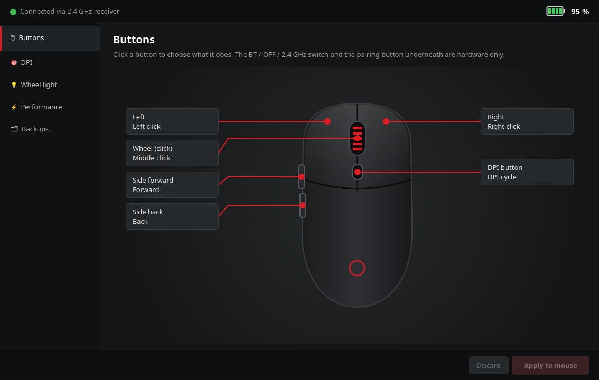
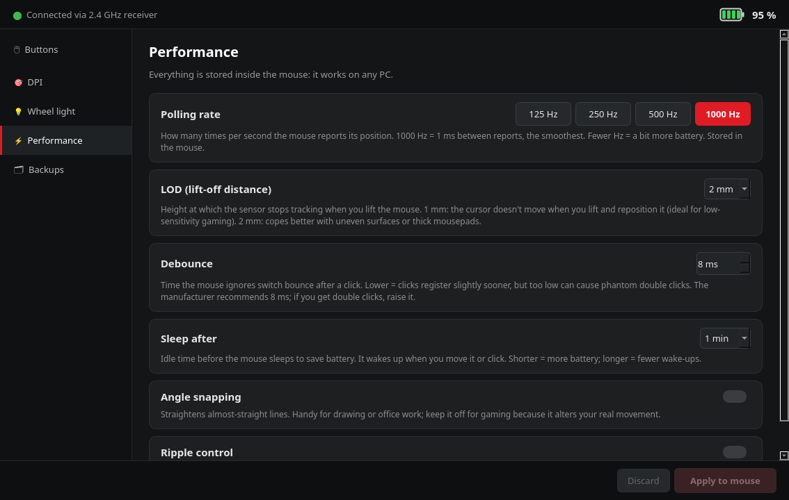
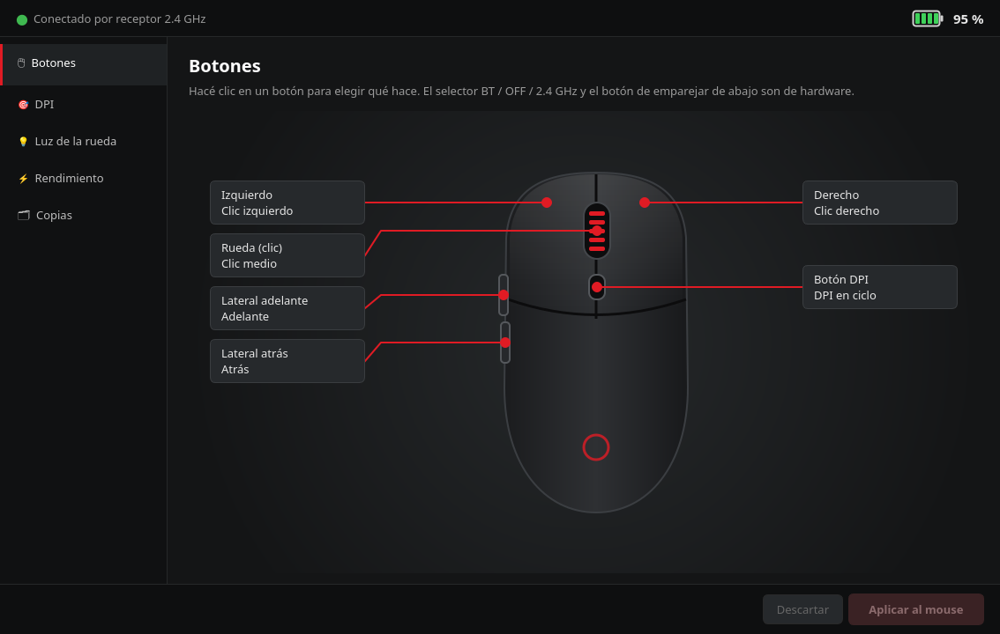
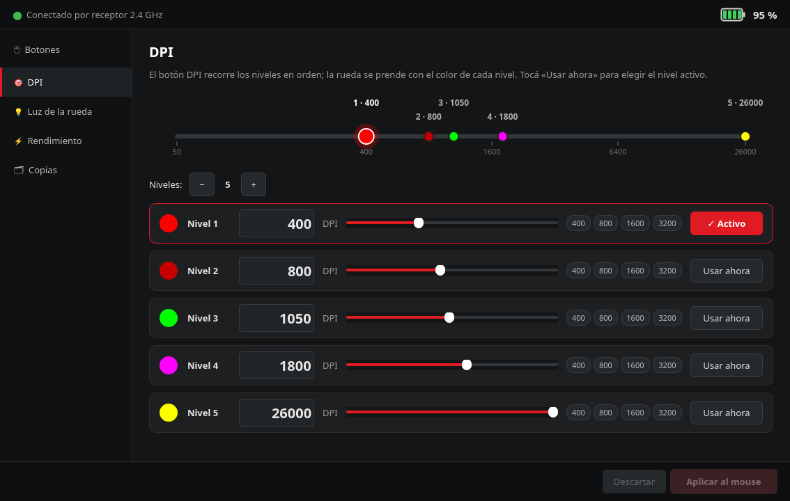

<div align="center">

# 🖱️ Redragon M917 ST4R Pro · Linux

**Configure your Redragon M917 ST4R Pro on Linux — no Windows, no Wine.**<br>
**Configurá tu Redragon M917 ST4R Pro desde Linux — sin Windows y sin Wine.**


[**English**](#-english) · [**Español**](#-español)



</div>

---

## 🇺🇸 English

Redragon only ships Windows software for this mouse. This app talks to it directly over
`hidraw`, so you can change everything from Linux. Settings are stored **inside the
mouse**, so they keep working on any PC.

### Features

| | Feature | Details |
|---|---|---|
| 🎯 | **DPI** | 1–8 levels, value (50–26000) and colour of each, active level shown live when you press the DPI button |
| 🖱️ | **Buttons** | Remap left, right, wheel, back, forward and DPI |
| ⚡ | **Polling rate** | 125 / 250 / 500 / 1000 Hz |
| 💡 | **Wheel LED** | On/off and brightness (1–10) |
| ⚙️ | **Advanced** | Lift-off distance, debounce, sleep time, angle snapping, ripple control |
| 🔋 | **Battery** | Level, charging state, auto-detects receiver / cable / sleeping mouse |
| 🛟 | **Backups** | Full copy of the mouse memory on every launch and before every change, restorable from the app |

<table>
<tr>
<td></td>
<td></td>
</tr>
<tr>
<td align="center"><sub>DPI levels</sub></td>
<td align="center"><sub>Performance</sub></td>
</tr>
</table>

### Compatibility

| Device | USB ID | Status |
|---|---|---|
| M917 ST4R Pro — 2.4 GHz receiver | `25a7:fa7c` | ✅ Supported |
| M917 ST4R Pro — USB cable | `25a7:fa7b` | ✅ Supported |
| M917 ST4R Pro — Bluetooth | — | ❌ The receiver is not used in BT mode |
| Other Redragon / Compx mice | — | ❌ Not supported (they may use a different memory map) |

### Install

Requirements: **Python 3** and **PyQt6** (`python-pyqt6` on Arch, `python3-pyqt6` on Debian/Ubuntu).

```sh
git clone https://github.com/Mapag8/redragon-m917-linux
cd redragon-m917-linux
./install.sh
```

Then open **Redragon M917** from your app menu.

`install.sh` installs to `~/.local` and adds one udev rule
(`/etc/udev/rules.d/70-redragon-m917.rules`, asks for your password once) so your user can
talk to the mouse without root. To remove it: `./uninstall.sh`.

### Safety

- 🛟 Automatic backup of the whole configuration before any write (`~/.local/share/redragon-m917/copias`).
- ✍️ Only the fields you changed are written, then read back and verified.
- 🚫 Refuses to apply a layout with no left-click button.
- 🔍 `redragon-m917 --selftest` is read-only: it decodes the config and checks that re-encoding gives the same bytes.

### Notes

- The battery % is reported in 5 % steps and is voltage based. On the cable it reads high,
  so — like the official app — it shows *Cargando* (charging) instead of a number.
- The UI is in **English or Spanish**, following your system language. Force one with
  `M917_LANG=en redragon-m917` (or `es`).
- How the mouse protocol works: [docs/PROTOCOL.md](docs/PROTOCOL.md).

---

## 🇦🇷 Español

¿Te compraste el **Redragon M917 ST4R Pro**, usás Linux y descubriste que el programa
oficial es solo para Windows? Somos dos. 🙃

Esta app habla directo con el mouse y te deja cambiar todo lo que cambia el programa
oficial, sin máquinas virtuales ni Wine. Está en **español** (rioplatense, obvio) y en
**inglés**: elige sola según el idioma de tu sistema. Y como la configuración se guarda **adentro del
mouse**, después la seguís teniendo en cualquier compu, aunque sea Windows.

### Qué podés hacer

| | Qué | Cómo |
|---|---|---|
| 🎯 | **DPI** | De 1 a 8 niveles, con el valor (50 a 26000) y el color de cada uno. Si tocás el botón DPI del mouse, la app lo muestra en el momento |
| 🖱️ | **Botones** | Cambiá qué hace cada uno: izquierdo, derecho, rueda, laterales y DPI |
| ⚡ | **Polling rate** | 125, 250, 500 o 1000 Hz |
| 💡 | **Luz de la rueda** | Prenderla, apagarla y elegir el brillo (1 a 10) |
| ⚙️ | **Avanzado** | Altura de despegue (LOD), debounce, tiempo para dormirse, angle snapping, ripple control. Cada opción viene explicada en criollo |
| 🔋 | **Batería** | Nivel y si está cargando. Se da cuenta sola si está con receptor, con cable o dormido |
| 🛟 | **Copias** | Guarda una copia de toda la memoria del mouse cada vez que la abrís y antes de cada cambio. Si algo sale mal, la restaurás con un clic |

<table>
<tr>
<td></td>
<td></td>
</tr>
<tr>
<td align="center"><sub>Botones</sub></td>
<td align="center"><sub>Niveles de DPI con sus colores</sub></td>
</tr>
</table>

### Instalación

Necesitás **Python 3** y **PyQt6** (en Arch y derivadas: `sudo pacman -S python-pyqt6`;
en Debian/Ubuntu: `sudo apt install python3-pyqt6`).

```sh
git clone https://github.com/Mapag8/redragon-m917-linux
cd redragon-m917-linux
./install.sh
```

Te va a pedir la contraseña **una sola vez**: es para una regla de udev que deja que tu
usuario hable con el mouse sin ser root. Después buscá **Redragon M917** en el menú de
aplicaciones y listo.

¿Te arrepentiste? `./uninstall.sh` la saca. Tus copias de seguridad se quedan donde
estaban, por las dudas.

### Antes de usarla

| | |
|---|---|
| 📡 | El mouse tiene que estar en **2.4 GHz o con cable**. En Bluetooth no pasa por el receptor y la app no lo ve |
| 😴 | Si el mouse se durmió, movelo un poco y la app lo encuentra sola |
| 🌐 | Si tu sistema está en otro idioma y la querés en español: `M917_LANG=es redragon-m917` |
| 🔋 | La batería va de a 5 %. Con el cable puesto el mouse marca de más, así que, igual que el programa oficial, muestra *Cargando* en vez del número |
| 🧪 | Está probada con **un** M917 ST4R Pro. Otros mouse de Redragon pueden parecerse, pero la app no los abre a propósito: si la memoria está ordenada distinto, podría escribir donde no debe |

### ¿Cómo funciona?

El mouse se configura con mensajes HID que van y vienen por el receptor. Todo lo que se
averiguó del protocolo (comandos, mapa de memoria, cómo se codifican los DPI y los
botones) está documentado en [docs/PROTOCOL.md](docs/PROTOCOL.md), por si querés hacer tu
propia herramienta o adaptarla a otro modelo.

---

<div align="center">
<sub>
Not affiliated with Redragon · Sin relación con Redragon<br>
Use at your own risk: the app writes to the mouse's configuration memory (with backups) ·
Usala bajo tu responsabilidad: escribe en la memoria del mouse (con copias de seguridad)<br>
GPL-3.0-or-later
</sub>
</div>
